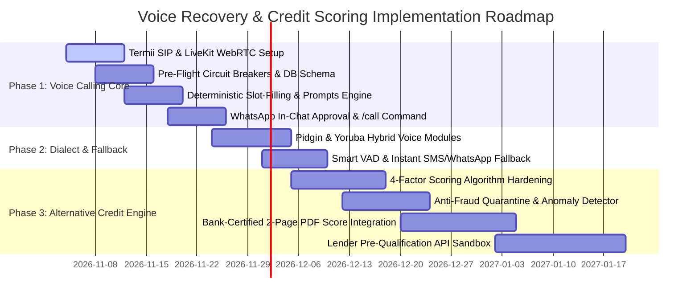

# Comprehensive Implementation Plan: Autonomous Voice Recovery & Alternative Credit Scoring Engine

**Product:** Waasz (WhatsApp AI Financial Operating System for African MSMEs)  
**Document:** Technical & Operational Implementation Plan  
**Version:** 1.0.0  
**Lead Architect:** Ndibueze Ifeanyi  

---

## 1. Executive Architecture Overview

```
                      ┌─────────────────────────────────────────┐
                      │         WhatsApp User Interface         │
                      │  (Merchant logs sales, sends commands)  │
                      └────────────────────┬────────────────────┘
                                           │
                                           ▼
                      ┌─────────────────────────────────────────┐
                      │          Waasz FastAPI Backend          │
                      │ ├─ Event Router & Circuit Breakers      │
                      │ ├─ Tenant-Isolated PostgreSQL/pgvector  │
                      │ └─ APScheduler Automation Daemon        │
                      └──────────────┬──────────────────┬───────┘
                                     │                  │
                ┌────────────────────┴─────┐      ┌─────┴────────────────────┐
                ▼                          ▼      ▼                          ▼
   ┌───────────────────────────┐ ┌───────────────────────────┐ ┌───────────────────────────┐
   │ Module A: Voice Recovery  │ │ Module B: Alternative     │ │ Module C: Anti-Fraud     │
   │ ├─ Termii / Africa's Talk │ │    Credit Scoring Engine  │ │    Quarantine Layer     │
   │ ├─ LiveKit / Vapi Gateway │ │ ├─ 4-Factor Weighted Model│ │ ├─ Anomaly Detection    │
   │ ├─ Deepgram Nova-2 (STT)  │ │ ├─ Transaction Velocity   │ │ ├─ Wash Trade Filter    │
   │ └─ ElevenLabs / MMS (TTS) │ │ └─ XGBoost Default Risk   │ │ └─ Receipt Cross-Check  │
   └───────────────────────────┘ └───────────────────────────┘ └───────────────────────────┘
```

---

## Part I: Autonomous GSM Voice Recovery & Calling Engine

### 1.1 Latest Model Research & Platform Benchmark (November 2026)

To deliver calls that sound human, respectful, and reliable over African cellular networks (MTN, Airtel, Glo), we benchmarked the lowest-latency, cost-effective models:

| Pipeline Stage | Recommended Platform / Model | Fallback / Alternative | Latency | Why It Fits Nigeria |
| :--- | :--- | :--- | :--- | :--- |
| **Telephony Gateway** | **Termii Voice API** / **Africa's Talking SIP** | Twilio Programmable Voice | $< 800\text{ms}$ connection | Native interconnects with Nigerian telcos; caller ID rotation support; localized billing in NGN. |
| **Voice Orchestration** | **LiveKit Agents** (Self-hosted on AWS) | **Vapi AI** (Managed API) | $< 400\text{ms}$ pipeline | WebRTC-to-SIP bridge, full control over call state, deterministic interruptibility (VAD). |
| **Speech-to-Text (STT)**| **Deepgram Nova-2 (African English / Multi)** | **OpenAI Whisper v3 Turbo** | $\approx 250\text{ms}$ | Exceptional accuracy with Nigerian accents, noisy market background noise cancellation. |
| **Reasoning Engine** | **Groq Llama-3.3 70B Versatile** | **OpenAI GPT-4o-mini** | $\approx 180\text{ms}$ TTFT | Sub-second streaming inference; cost under $0.0005 per turn; strictly bound by deterministic system prompts. |
| **Text-to-Speech (TTS)**| **Cartesia Sonic** / **ElevenLabs African Accents** | **Meta MMS** (Yoruba/Hausa/Igbo) | $\approx 150\text{ms}$ | Natural African intonation, correct pronunciation of local names (*Ngozi, Chidi, Balogun*), high warmth. |

---

### 1.2 Call Flow & The "No-Hallucination" Architecture

To ensure the AI **never** quotes wrong figures, mispronounces names, or hallucinates balances, the voice agent is **strictly slot-filled from PostgreSQL**:

```
[Trigger via Overdue Schedule or Merchant /call command]
                           │
                           ▼
[Pre-Flight Verification: Circuit Breaker Checks]
  1. Is debt.status still == "pending"? (If paid, abort)
  2. Is customer phone E.164 verified (+234...)?
  3. Has merchant approved the call? (Check opt-in flag)
                           │
                           ▼
[Generate Deterministic Call Payload]
  • Customer: {{customer_name}}
  • Store: {{store_name}}
  • Balance: {{formatted_naira}}
  • Due Date: {{due_date}}
  • Bank Details: {{merchant_bank}}
                           │
                           ▼
[Initiate Outbound Call via Termii / Africa's Talking]
  • Rotating Local Caller ID (080... or 090...)
                           │
                           ▼
[Interactive Call Experience]
  • First 3 Seconds: Human, respectful greeting (Sir/Ma) + Store Reference.
  • Voice Activity Detection (VAD): If silence > 4s, play graceful fallback and dispatch WhatsApp/SMS.
  • DTMF / Voice Response:
      - Press 1: "Send account details to my WhatsApp right now"
      - Press 2: "I have transferred the money" (triggers merchant verification ping)
      - Press 3: "Request 48-hour extension"
                           │
                           ▼
[Call Outcome Handled]
  • Update Database: Log call transcript, duration, and status in debt_notes.
  • WhatsApp Ping to Merchant: Immediate feedback summary on WhatsApp.
```

---

### 1.3 Multilingual & Dialect Implementation Matrix

To speak to merchants and debtors across different trade clusters:

| Dialect / Language | Primary Target Cluster | Implementation Strategy |
| :--- | :--- | :--- |
| **Nigerian English / Pidgin** | Balogun, Trade Fair, Alaba (Lagos), Port Harcourt | ElevenLabs African Voice / Cartesia Sonic dynamically voiced with deterministic parameters. |
| **Yoruba** | Lagos Island, Ibadan (Bodija, Gbagi), Ogun | **Hybrid System:** Studio-recorded native audio headers (`"Ẹ káàrọ̀ sir..."`) + dynamic local TTS for amounts. |
| **Hausa** | Kano (Kafin Wambai), Kaduna, Abuja | Meta MMS TTS fine-tuned on northern trade vocabulary + Studio audio clips. |
| **Igbo** | Onitsha Main Market, Aba (Ariaria), Nnewi | Studio-recorded greetings (`"Ụtụtụ ọma sir..."`) + dynamic number insertion. |

---

## Part II: The Alternative Credit Scoring Engine (300–850 Scale)

The rule-based prototype is upgraded into an **institutional, explainable underwriting engine** designed for commercial microfinance banks (MFBs), SMEDAN, and fintech lenders.

### 2.1 The 4-Factor Weighted Model (Mathematical Formulation)

$$\text{Waasz Score} = 300 + 550 \times \left( 0.35 \cdot V_{\text{turnover}} + 0.25 \cdot S_{\text{cashflow}} + 0.25 \cdot R_{\text{recovery}} + 0.15 \cdot E_{\text{inventory}} \right)$$

```
                                      WAASZ CREDIT SCORE (300 - 850)
                                                    │
         ┌──────────────────────────┬───────────────┴──────────────┬──────────────────────────┐
         ▼                          ▼                              ▼                          ▼
   [Factor 1: 35%]            [Factor 2: 25%]                [Factor 3: 25%]            [Factor 4: 15%]
Transaction Velocity      Cash Flow Predictability       Debt Recovery Discipline   Inventory & Audit Health
• Active trading days     • Cash-to-credit sales ratio   • On-time collection rate  • Stock turnover speed
• Month-over-month growth • Liquidity volatility         • Default / write-off rate • Expense recording ratio
• Seasonal resilience     • Net operating margins        • Avg collection turnaround• Dead capital index
```

#### Detailed Breakdown of Factors:

1. **Transaction Velocity & Stability (35% — Max 192.5 pts):**
   * *Formula:* $V = 0.6 \cdot \min\left(1.0, \frac{\text{Active Days in Last 30}}{24}\right) + 0.4 \cdot \min\left(1.0, \frac{\text{Verified Sales Vol}}{\text{Target Baseline}}\right)$
   * Evaluates business pulse. An active retailer logging 20–25 days a month proves daily customer footfall.

2. **Cash Flow Predictability & Operating Margins (25% — Max 137.5 pts):**
   * *Formula:* $S = 0.5 \cdot \text{Operating Margin Factor} + 0.5 \cdot \text{Cash Inflow Ratio}$
   * Evaluates if the merchant is generating real operating profit rather than just churn. Quarantined or unverified entries are mathematically excluded from margin calculations.

3. **Debt Recovery Discipline & Receivables Health (25% — Max 137.5 pts):**
   * *Formula:* $R = 0.7 \cdot \left(\frac{\text{Paid Matured Debt}}{\text{Total Matured Debt}}\right) + 0.3 \cdot \min\left(1.0, \frac{14}{\text{Avg Days to Collect}}\right)$
   * The core differentiator: Measures debtor recovery velocity. Merchants who actively use Waasz IOUs to collect debts within 7–14 days receive top points.

4. **Inventory Turn & Auditability Discipline (15% — Max 82.5 pts):**
   * *Formula:* $E = 0.5 \cdot \text{Clean Audit Ratio} + 0.5 \cdot \text{Expense Capture Consistency}$
   * Evaluates completeness of records: does the merchant record restock expenses as well as sales, or only revenue?

---

### 2.2 The Anti-Fraud & Transaction Quarantine Layer

To ensure merchants cannot "game" the system (e.g. logging 10 fake ₦1,000,000 sales to artificially boost their credit score before applying for a loan):

1. **Synthetic Volume Spike Filter:**
   * If daily transaction volume exceeds $3.5\times$ the 30-day moving average without an accompanying receipt image or invoice, it is automatically marked `is_credit_eligible = False` and placed in **Quarantine**.
2. **Wash-Trading / Circular Debt Detection:**
   * If customer phone numbers belong to registered staff members or the merchant themselves, credit sales to these numbers are excluded from credit calculations.
3. **Round-Number Inflation Audit:**
   * A sudden burst of large round numbers (e.g. exactly ₦500,000, ₦1,000,000, ₦2,000,000 within minutes) triggers an audit flag requiring receipt photo verification.
4. **Cryptographic Proof of Daily Consistency:**
   * Every day's ledger is sealed with an automated cryptographic SHA-256 hash. Lenders can verify that transactions were recorded chronologically on distinct calendar days, rather than backfilled in a single night.

---

### 2.3 Machine Learning Layer: Default Risk Classifier (Phase 2 Upgrade)

* **Algorithm:** LightGBM / XGBoost binary classification model.
* **Target Output:** Probability of Default ($PD \in [0.0, 1.0]$) within a 90-day micro-loan tenor.
* **Input Feature Vector:**
  * 30-day / 60-day GMV, Gross Margin %, Expense Ratio.
  * Number of distinct repeat customers.
  * Average IOU recovery duration (days).
  * 30-Day Record Streak count.
  * Peak-to-trough cash flow variance.
* **Output Deliverable:** Integrated directly into the **2-Page Bank Health Profile PDF** with a visual risk gauge and QR-verifiable validation link.

---

## Part III: Infrastructure, Tools & Platform Requirements

### Complete Inventory of What We Need:

#### 1. Telephony & Communication APIs:
* **Meta WhatsApp Cloud API (v21.0+):** (Already configured & active).
* **Termii Account:** For Nigerian local mobile outbound dialing (SIP trunks) and instant SMS payment links.
* **LiveKit Cloud / Self-Hosted Gateway:** WebRTC voice orchestration bridge connecting the telecom SIP trunk to our AI backend.

#### 2. AI & Audio Processing:
* **Deepgram Nova-2 API:** High-speed streaming transcription with accent resistance.
* **Groq API Key:** Llama-3.3 70B for sub-200ms conversational turn management.
* **ElevenLabs / Cartesia API Key:** Low-latency African English and Pidgin text-to-speech.

#### 3. Database & Core Backend (Existing Infrastructure):
* **PostgreSQL (Supabase) + pgvector:** Database and semantic customer memory.
* **FastAPI + Asyncpg:** Asynchronous API handling concurrent webhooks and call states.
* **ReportLab:** Vector PDF rendering engine for A4 receipts, IOUs, and Bank Health Statements.
* **Redis / Celery:** Task queue for managing outbound call schedules, retries, and rate limits.

---

## Part IV: Step-by-Step Implementation Roadmap



### Milestone Deliverables:

* **Milestone 1 (Voice Calling MVP - 2 Weeks):** 
  * Merchant can type `/call [Customer]` on WhatsApp.
  * System dials debtor via Termii, speaks courteous Nigerian English notice with exact name and balance, and pings the merchant on WhatsApp with the outcome.
* **Milestone 2 (Dialect & Auto-Escalation - 3 Weeks):**
  * Automated Day-7 overdue trigger with merchant one-tap WhatsApp approval.
  * Support for Pidgin and Yoruba greetings.
  * Rotating caller ID pool to prevent call blocking.
* **Milestone 3 (Hardened Alternative Credit Engine - 4 Weeks):**
  * Automated execution of the 4-factor scoring model ($300 - 850$).
  * Synthetic transaction quarantine filter preventing fraud.
  * Instant generation of updated QR-verified 2-Page Health Profile PDFs for bank loan officers.
