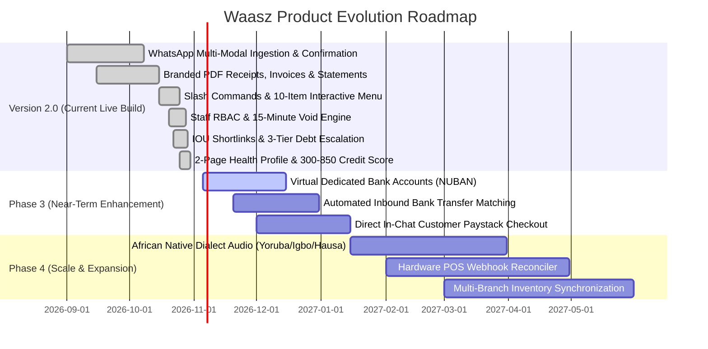

# Product Requirements Document (PRD)

**Product Name:** Waasz (WhatsApp AI Business Analyst & Smart Bookkeeping Operating System)  
**Document Version:** 2.0.0  
**Build Release:** Version 2.0 (Current Production Build)  
**Target Market:** Nigeria & Sub-Saharan Africa Micro, Small, and Medium Enterprises (MSMEs)  
**Status:** Approved / Active Production  
**Lead Product Team:** Waasz Engineering & Product Leadership  

---

## 1. Executive Summary

**Waasz** is a WhatsApp-native artificial intelligence business management and financial operating system engineered specifically for informal micro, small, and medium enterprises (MSMEs) in emerging markets.

In Nigeria and across Sub-Saharan Africa, over **39.6 million MSMEs** generate nearly **50% of national GDP** and account for **96% of all businesses**. However, fewer than **5% have access to formal commercial credit**, resulting in a devastating **$158B+ to $236B financing gap** (World Bank / IFC MSME finance studies). The root cause is not insolvency, but **information asymmetry**: informal merchants conduct business through oral transactions, paper notebooks, or mental tallies. Because they lack structured, verifiable records, formal financial institutions and trade suppliers classify them as high-risk or unbankable.

Previous standalone bookkeeping mobile applications struggled with catastrophic 30-day user churn because they forced non-tech-savvy merchants to download heavy apps, consume scarce mobile storage and cellular data, and master complex double-entry accounting terminology (*debits, credits, ledgers*).

**Waasz breaks this adoption barrier by turning WhatsApp—the primary communication application African merchants already use every day—into an intelligent CFO.** Merchants simply send casual voice notes, text messages in English or Nigerian Pidgin (e.g., *"Sold 2 bags of sugar ₦30k"*), or pictures of receipts. Waasz's multi-agent AI cascade extracts the transaction, seeks single-tap interactive confirmation, writes it to an immutable double-entry ledger, generates branded PDF customer receipts, tracks debtor balances with one-tap short links, delivers multi-cadence business intelligence, and compiles verified financial statements and institutional business health profiles.

---

## 2. Problem Statement & Market Context

### 2.1 The Problem
1. **The Burden of Paper & Oral Record-Keeping:** Over 80% of informal retailers log sales in physical paper ledgers (*"ledger books"*) that are easily lost, stained, stolen, or damaged by moisture. When paper records vanish, business history, customer balances, and supplier accounts disappear with them.
2. **Customer Debt Bleed:** Informal retail relies heavily on short-term customer credit (*"buy now, pay on Friday"*). Without automated tracking, structured agreements, and polite escalation reminders, merchants lose an estimated **15% to 25% of monthly revenue** to forgotten or uncollected customer debts.
3. **The Credit & Financial Exclusion Trap:** When merchants seek working capital, supplier credit lines, trade financing, or institutional facilities, they are routinely turned down because they cannot produce 6 to 12 months of verifiable, structured financial records.
4. **App Fatigue & Digital Friction:** Micro-retailers operate on low-storage Android smartphones and metered cellular data. They routinely uninstall standalone apps within 7 to 14 days. Any solution requiring an app store download faces severe acquisition and retention headwinds.
5. **Team & Staff Accountability:** As sole proprietors take on apprentices or sales assistants, they lack tools to delegate bookkeeping without exposing private profit margins, net revenue, and banking details.

### 2.2 Market Opportunity & Addressable Market
* **Total Addressable Market (TAM):** 39.6 million MSMEs in Nigeria; 90M+ across Sub-Saharan Africa.
* **Serviceable Addressable Market (SAM):** 18.2 million smartphone-enabled, WhatsApp-active commercial retailers, service providers, wholesalers, and artisans in commercial centers (Lagos, Kano, Onitsha, Aba, Ibadan, Abuja, Port Harcourt).
* **Serviceable Obtainable Market (SOM):** 250,000 active MSMEs within 24 months, monetized at a blended ₦2,500 – ₦5,000 monthly subscription fee (yielding an ARR potential of ₦7.5B – ₦15B / ~$5M – ~$10M USD).

---

## 3. User Personas

### Persona A: The Fast-Paced Retail Trader ("Mama Ngozi")
* **Profile:** 46-year-old provision shop owner in Balogun Market, Lagos. High daily transaction volume (80–150 cash and bank transfer sales daily).
* **Pain Point:** Has no time to type during peak market hours. Writing in paper notebooks leads to forgotten sales and untracked customer balances.
* **Waasz Solution:** Records 5-second voice notes on WhatsApp (*"Sold 3 cartons of Indomie ₦24,000 to Iya Basira, she paid cash"*). Waasz logs it immediately, updates inventory, and tracks cash positions.

### Persona B: The Service Provider & Artisan ("Tunde")
* **Profile:** 29-year-old bespoke fashion designer in Ibadan. Employs 2 apprentices. Sells custom clothing across Nigeria via Instagram and WhatsApp.
* **Pain Point:** Customers demand instant receipts to trust online bank transfers. Lacks an invoicing system or computer. Struggles to calculate net profit after buying fabrics, thread, and generator fuel.
* **Waasz Solution:** Types *"Received ₦45,000 advance payment from Dr. Adeleke for 2 agbada"*. Waasz immediately replies with a professionally branded PDF receipt that Tunde forwards directly to the customer. Staff log fabric purchases while net profit remains visible only to Tunde.

### Persona C: The Expanding Wholesaler ("Alhaji Garba")
* **Profile:** 52-year-old building materials and electrical wholesaler in Kano. Extends significant credit to sub-dealers and contractors.
* **Pain Point:** Millions of Naira tied up in receivables. Reconciling who owes what is a weekend-long headache. Needs formal records to establish supplier credit terms and institutional trade facilities.
* **Waasz Solution:** Checks debt positions anytime via `/debtors`. Generates an official 30-day verified business statement PDF or 2-page institutional health profile PDF with structured cash flow metrics and record consistency streaks.

---

## 4. System Architecture & Technical Stack

```
+-----------------------------------------------------------------------------------+
|                                 WAASZ PLATFORM ARCHITECTURE                       |
+-----------------------------------------------------------------------------------+
|                                                                                   |
|  [ WhatsApp Client (Voice Notes / Text / Photos / Interactive Buttons & Menus) ]  |
|                       |                                                           |
|                       v                                                           |
|  [ Meta Cloud API Webhook Gateway (HMAC-SHA256 Signed, 24h Care Window Aware) ]   |
|                       |                                                           |
|                       v                                                           |
|  [ Inbound Router & Command Dispatcher (CommandRouter) ]                           |
|    - Slash Commands (/menu, /receipt, /invoice, /iou, /statement, /profile, etc.) |
|    - Interactive List Drawers (10-Item Meta Action Menu)                          |
|    - Role-Based Actor Resolution (Owner vs. Staff Context)                        |
|                       |                                                           |
|                       v                                                           |
|  [ Multi-Provider AI Inference Engine (AgentService) ]                             |
|    - Google Gemini 2.5 / Flash (Primary Multimodal & High-Context Extractor)      |
|    - Groq LLaMA 3.3 70B (Sub-Second Fallback Extractor)                            |
|    - OpenAI (Dynamic Failover Guard)                                              |
|                       |                                                           |
|                       v                                                           |
|  [ Two-Stage Confirmation Gate (Zero Silent Corruption) ]                         |
|    - 2-Button Interactive Reply ("1 Yes" / "2 Edit")                              |
|                       |                                                           |
|                       v                                                           |
|  [ Core Business Operating Services ]                                             |
|    - Double-Entry Ledger & Inventory Management                                   |
|    - Staff RBAC & Seat Limit Enforcement (StaffService)                           |
|    - Transaction Reversal & Void Engine with Inventory Restoral (15m staff limit) |
|    - Branded PDF Engine (Receipts, Invoices, Statements, Health Profiles)         |
|    - Debt Management & Escalation Engine (IOU Shortlinks, 3-Stage Notices)        |
|    - Business Intelligence & Analytics (Pareto 80/20, Dead Stock, Margin Sim)     |
|    - Automated APScheduler Suite (14 Background Cron/Interval Jobs)               |
|    - Sovereign Google Drive Cloud Mirroring                                       |
|                       |                                                           |
|                       v                                                           |
|  [ PostgreSQL Storage Layer (JSONB, Async SQLAlchemy, Connection Pooling) ]       |
|                       |                                                           |
|                       v                                                           |
|  [ Telemetry, Client Web Dashboard & Founder Admin Panel ]                        |
|    - Client Magic-Link Web Dashboard (FastAPI / Jinja2 / Chart.js)                |
|    - Founder Real-Time Operations Telemetry (Streamlit)                           |
|                                                                                   |
+-----------------------------------------------------------------------------------+
```

### 4.1 Technology Stack Specifications
* **Core Language & Framework:** Python 3.12, FastAPI (high-concurrency async ASGI application).
* **Database & ORM:** PostgreSQL with Async SQLAlchemy, asyncpg driver, JSONB metadata structures.
* **Document Generation:** ReportLab for vector-grade PDF rendering (Receipts, Invoices, Statements, Health Profiles).
* **Scheduling & Background Tasks:** APScheduler with 14 persistent cron and interval jobs.
* **Cloud Infrastructure:** AWS EC2 Ubuntu LTS, Nginx reverse proxy with TLS 1.3, DuckDNS dynamic DNS resolution (`waasz-sme-api.duckdns.org`), Systemd service supervision.
* **Integration Interfaces:** Meta WhatsApp Cloud Business API, Google Drive API v3 (OAuth2 flow), Paystack Payment Gateway.

---

## 5. Functional Requirements & Feature Modules (Version 2.0)

### Module 1: WhatsApp-Native Multimodal Ingestion
* **Req 1.1 — Multimodal Message Processing:** Accept text messages, WhatsApp voice audio notes (`.ogg` Opus format), and photograph images of physical receipts, invoices, or handwritten notes.
* **Req 1.2 — Colloquial & Pidgin NLP Resilience:** Correctly parse Nigerian commercial terminology, shorthand, and currency expressions:
  * *"Sold 2 bags of rice ₦70k"* $\rightarrow$ Sale: 2 bags of rice @ ₦35,000, Total = ₦70,000.
  * *"Collected 15k from Emeka for yesterday debt"* $\rightarrow$ Debt Repayment: ₦15,000, Customer = Emeka.
  * *"Bought fuel ₦8,500 for generator"* $\rightarrow$ Expense: Fuel @ ₦8,500.
* **Req 1.3 — Voice Transcription:** Inbound audio notes are transcribed via speech-to-text inference before routing to the multi-agent extraction pipeline.

---

### Module 2: The Two-Stage Confirmation Gate
* **Req 2.1 — Draft Stage:** When an incoming message is parsed, construct an ephemeral draft (`Confirmation` record) containing unit prices, item quantities, total amount, customer name (if credit), and classification.
* **Req 2.2 — Interactive WhatsApp Buttons:** Respond to the merchant with interactive WhatsApp button choices:
  * Button 1: `✅ 1 Yes` (Commits draft to immutable double-entry ledger).
  * Button 2: `✏️ 2 Edit` (Allows merchant to alter amounts, items, or parameters).
* **Req 2.3 — Auto-Timeout & Idempotency:** Unconfirmed drafts expire automatically after 24 hours to prevent stale ledger pollution. Confirmed records receive a unique UUID and cryptographic hash.

---

### Module 3: Slash Commands & WhatsApp Interactive List Menu
* **Req 3.1 — Interactive Action Drawer (`/menu`):** Renders a native WhatsApp 10-row interactive list menu (respecting Meta’s 10-row constraint per section list) categorized into logical business domains:
  1. **Invoices & Receipts:**
     * `cmd_receipt` — Cash Receipt (PDF download for latest cash sale)
     * `cmd_invoice` — Credit Invoice (Credit sale invoice with repayment terms)
     * `cmd_iou` — Customer IOU Link (1-tap WhatsApp debt forward link)
  2. **Reports & Statements:**
     * `cmd_statement` — Business Statement (30-day verified official PDF ledger)
     * `cmd_profile` — Health Profile PDF (2-page institutional business health report)
     * `cmd_report` — Daily Summary (On-demand sales, profit, and margin report)
  3. **Team & Ledger:**
     * `cmd_staff` — Staff & Team (View team members and seat limits)
     * `cmd_debtors` — Debtors Table (Active customer debt balances)
     * `cmd_void` — Void Last Entry (Cancel last confirmed transaction and restore inventory)
  4. **Stock & Inventory:**
     * `cmd_stock` — Stock Inventory (Stock on hand and low-stock alerts)
* **Req 3.2 — Comprehensive Slash Command Registry:** Support direct typed commands and aliases:
  * `/menu`, `/help`, `/commands` $\rightarrow$ Interactive menu drawer.
  * `/receipt`, `/rcpt` $\rightarrow$ Latest cash receipt PDF.
  * `/invoice`, `/inv` $\rightarrow$ Latest credit sale invoice PDF.
  * `/iou` $\rightarrow$ Shortened customer debt acknowledgement link.
  * `/debtors`, `/debts`, `/whoowesme` $\rightarrow$ Outstanding customer receivables table.
  * `/statement`, `/stmt` $\rightarrow$ Official 30-day verified financial statement PDF.
  * `/profile`, `/healthprofile` $\rightarrow$ 2-page institutional business health profile PDF.
  * `/score`, `/creditscore`, `/streak` $\rightarrow$ Business credit score (300–850) and record continuity streak.
  * `/sales`, `/revenue`, `/profit` $\rightarrow$ Today’s sales and cashflow summary.
  * `/expenses`, `/costs` $\rightarrow$ Today’s operating expense breakdown.
  * `/stock`, `/inventory` $\rightarrow$ Full inventory listing and valuation.
  * `/lowstock`, `/reorder` $\rightarrow$ Filtered view of items below minimum stock threshold.
  * `/chart`, `/graph` $\rightarrow$ In-chat visual trend chart and web dashboard access.
  * `/drive`, `/connectdrive` $\rightarrow$ Sovereign Google Drive backup authorization.
  * `/disconnectdrive` $\rightarrow$ Unlink Google Drive integration.
  * `/report`, `/daily` $\rightarrow$ On-demand daily ledger reconciliation.
  * `/void`, `/cancel`, `/delete` $\rightarrow$ Transaction cancellation with inventory restoral.
  * `/staff`, `/team` $\rightarrow$ Team member roster and seat availability.
  * `/addstaff [name] [phone]` $\rightarrow$ Onboard new staff member.
  * `/removestaff [phone|name]` $\rightarrow$ Deactivate staff member access.

---

### Module 4: Branded Digital PDF Documents
* **Req 4.1 — Dynamic Thermal & Vector Styling:** Generates publication-grade PDF documents dynamically via ReportLab.
* **Req 4.2 — Document Suite:**
  * **Cash Receipt PDF:** Dynamic merchant branding, address, bank details, itemized lines, subtotal, tax/discounts, and timestamp.
  * **Credit Sale Invoice PDF:** Explicit credit indicator, customer name, payment due date, and payment instructions.
  * **30-Day Official Verified Business Statement PDF:** Complete 30-day double-entry ledger export detailing opening balance, verified sales, operating expenses, net cash flow, debt repayments, and unique transaction reference codes. Delivered directly to WhatsApp chat via `send_document_bytes`.
  * **2-Page Institutional Business Health Profile PDF:** Executive-grade business performance summary including:
    * Page 1: Revenue velocity, monthly sales volume, operating expense ratio, net margin, and 30-day record continuity streak.
    * Page 2: Mathematical score contribution breakdown across a 300–850 business credit scale, liquidity health indicators, and customer debt recovery metrics.

---

### Module 5: Customer Debt Management & Shortlink Recovery Engine
* **Req 5.1 — Automatic Debt Ledger:** Credit sales automatically register under the linked `Customer` record.
* **Req 5.2 — Shortened IOU Magic Links (`/i/{code}`):** Waasz generates clean, shortened URLs (`https://waasz-sme-api.duckdns.org/i/{code}`) containing customer debt details and bank transfer instructions. Merchants forward the link to customers in one tap.
* **Req 5.3 — 3-Tier Debt Escalation Protocol:** Automated or merchant-triggered reminder notices:
  1. *Gentle Reminder (Friendly):* Courtesy notice sent prior to or on the due date.
  2. *Formal Overdue Notice (Standard):* Professional notice highlighting overdue status, balance, and bank transfer details.
  3. *Urgent Demand Notice (Firm):* Final formal demand requesting immediate settlement to avoid trade credit suspension.
* **Req 5.4 — Receivables Lookup:** Merchants can query outstanding balances anytime via `/debtors` or natural language (*"Who owes me?"*, *"How much does Chidi owe?"*).

---

### Module 6: Transaction Reversal & Void Engine
* **Req 6.1 — Safe Transaction Reversal (`/void`):** Allows merchants to cancel an erroneous transaction without manual database intervention.
* **Req 6.2 — Automatic Inventory Restoral:** Voiding a sale automatically replenishes deducted stock quantities back into the inventory ledger.
* **Req 6.3 — Credit Reversal:** Voiding a credit sale automatically cancels or deducts the associated customer debt balance.
* **Req 6.4 — Role-Based Security Windows:**
  * **Business Owner:** Unrestricted void permissions for any transaction.
  * **Staff Members:** Restricted to a **15-minute void window** (`VOID_WINDOW = 15 minutes`) from transaction creation time to prevent unauthorized ledger tampering.
* **Req 6.5 — Audit Trail:** Every void action records an immutable audit log entry capturing the initiating actor (`member_id`), original transaction ID, timestamp, and reversal details.

---

### Module 7: Multi-Staff Management & Role-Based Access Control (RBAC)
* **Req 7.1 — Plan-Based Seat Limits:** Staff seat limits are strictly enforced by subscription tier:
  * `free`: 1 seat (Owner only)
  * `pilot`: 2 seats (Owner + 1 staff)
  * `pro`: 10 seats
  * `growth`: 25 seats
  * `scale`: 50 seats
  * `enterprise`: 100 seats
* **Req 7.2 — In-Chat Staff Administration:**
  * `/staff` $\rightarrow$ Displays active team members, assigned phone numbers, and remaining seat capacity.
  * `/addstaff [name] [phone]` $\rightarrow$ Creates member profile, generates unique WhatsApp onboarding invite, and validates phone format.
  * `/removestaff [phone|name]` $\rightarrow$ Revokes member access immediately.
* **Req 7.3 — Permission Segregation:**
  * **Owner:** Full visibility into net profit, operating margins, team analytics, financial statements, health profiles, staff management, and unrestricted voiding.
  * **Staff:** Permitted to record sales, log operating expenses, issue receipts, check stock, and void transactions within the 15-minute window. Prohibited from accessing business profit margins, executive health profiles, or owner telemetry.

---

### Module 8: Business Intelligence, Analytics & Multi-Cadence Reporting
* **Req 8.1 — Automated Multi-Cadence Rollups:**
  * **Daily Evening Rollup (6:00 PM – 9:00 PM Local Time):** Dispatched via APScheduler. Summarizes gross sales, cash vs. credit breakdown, operating expenses, estimated net profit, and receivables logged. Built with fallback template resilience (`daily_business_summary_v1` falling back to `daily_ledger_reconciliation_v1`).
  * **Weekly Unified Performance Report:** Dispatched every Sunday with revenue trends, top-selling items, and cash flow health indicators.
  * **Monthly, Quarterly & Yearly Reviews:** Strategic financial retrospectives delivered at calendar boundaries.
* **Req 8.2 — Advanced Commercial Analytics:**
  * **Pareto Analysis (80/20 Rule):** Identifies top 20% of inventory items driving 80% of revenue.
  * **Dead Stock Alerts:** Flags inventory items with zero movement over 30/60-day periods.
  * **Team Sales Breakdown:** Attributes sales volume across staff members for performance attribution.
* **Req 8.3 — In-Chat Visual Trend Charts:** Generates clean graphical charts (Sales vs. Expenses vs. Margin) delivered directly to WhatsApp chat.
* **Req 8.4 — Interactive Web Dashboard:** Provides secure, short-lived magic links for full browser-based data exploration, featuring automatic origin resolution (`get_base_origin`) and clean 302 HTTP redirects.

---

### Module 9: Business Credit & Financial Health Scoring
* **Req 9.1 — 300 to 850 Scoring Framework:** Algorithmic financial health index evaluating:
  1. *Record Continuity & Streak:* Consistent daily bookkeeping activity (e.g., 30-Day Record Streak).
  2. *Cash Flow Stability:* Revenue volume and month-over-month predictability.
  3. *Operating Margin Health:* Ratio of operating expenses to gross revenue.
  4. *Debt Recovery Velocity:* Average customer credit collection turnaround.
* **Req 9.2 — Tier Classifications:** Categorizes businesses into structured health tiers (e.g., Tier 1 Established, Tier 2 Developing Activity, Tier 3 Emerging) to benchmark operational maturity.

---

### Module 10: Data Privacy, NDPA Compliance & Sovereign Google Drive Vault
* **Req 10.1 — Nigeria Data Protection Act (NDPA 2023) Compliance:** Merchant financial data is encrypted at rest (AES-256) and in transit (TLS 1.3), partitioned by business tenant, and never sold, leased, or utilized to train external public models.
* **Req 10.2 — Sovereign Google Drive Mirroring:** Merchants can authorize their personal Google Drive via `/drive`. On the 1st of every month, an automated background job generates an encrypted financial backup (PDF + CSV ledger) and uploads it directly to their private Drive vault.

---

### Module 11: 14-Day Free Trial & Monetization Lifecycle
* **Req 11.1 — Frictionless Onboarding:** Self-service registration via WhatsApp without waitlists or manual credit card requirements. Instantly activates a 14-day full-access trial.
* **Req 11.2 — Guided 3-Step Setup Wizard:**
  1. Business Name prompt and NDPA consent.
  2. Store Address and Bank Account details for customer receipt headers (with skip option).
  3. Immediate transaction logging readiness.
* **Req 11.3 — Week 1 Review & Feedback Check-In:** At the end of Week 1, automated check-in requests a 1–5 star rating and feature suggestions, persisted in database telemetry.
* **Req 11.4 — Day 12 Pre-Expiry Notice:** Dispatches automated WhatsApp notification presenting continuation options:
  * **Option A (Instant Renewal - ₦1,000 Flat):** Promotional flat access pegged at **₦1,000 / month** via Paystack or direct bank transfer.
  * **Option B (Viral Referral Program):** Merchant shares unique referral link (`wa.me/[NUMBER]?text=START+REF_[CODE]`). Every 4 activated referrals award **+14 days of free trial**.
* **Req 11.5 — Day 14 Soft-Lock:** Automated congratulatory trial summary with soft-lock of new transaction logging until renewal or referral completion.
* **Req 11.6 — Founder Overrides:** Administrative ability to grant trial extensions (+14, +30 days) or mark merchants as permanently active (`is_lifetime_free = True`).

---

### Module 12: Real-Time Founder & Operations Telemetry Dashboard
* **Req 12.1 — Live Streamlit Architecture:** Telemetry dashboard (`admin/streamlit_app.py`) providing live 10-second polling against PostgreSQL.
* **Req 12.2 — Key Operations Metrics:**
  * Active registered businesses and onboarding funnel status.
  * 24-hour inbound/outbound WhatsApp message throughput.
  * Confirmed transactions, draft conversion rates, and void frequencies.
  * AI inference cost per token event and model provider distribution.
  * Real-time trial expiry tracker, referral conversion table, and Week-1 merchant feedback.
* **Req 12.3 — Operations Controls:** Direct WhatsApp broadcast tools, system capacity adjustments, access gate controls (`open`, `invite_code`, `allowlist`), and account recovery tools.

---

## 6. Background Automation Suite (APScheduler)

Waasz runs 14 dedicated background jobs ensuring operational continuity, customer engagement, and database health:

| Job ID | Cadence / Trigger | Function & Description |
| :--- | :--- | :--- |
| `dispatch_daily_unified_reports` | Daily @ 6:00 PM – 9:00 PM | Compiles and sends daily business ledger summaries to merchants. |
| `dispatch_daily_inactivity_nudges` | Daily (Configurable) | Sends gentle check-ins to merchants with zero logged activity today. |
| `dispatch_weekly_unified_reports` | Every Sunday | Dispatches weekly performance insights, top products, and cash flow reports. |
| `dispatch_monthly_unified_reports` | 1st of every month | Compiles comprehensive monthly financial retrospectives. |
| `dispatch_quarterly_unified_reports`| Quarterly | Generates quarterly operational health reviews. |
| `dispatch_yearly_unified_reports`   | Annually | Generates annual performance summaries. |
| `dispatch_monthly_google_drive_backups` | 1st of every month | Exports PDF/CSV ledgers directly to merchants' connected Google Drive accounts. |
| `send_task_reminders` | Interval (Every 5 mins) | Dispatches due task and customer payment reminders. |
| `check_trial_lifecycle` | Interval (Hourly) | Monitors trial aging, sends Day 12 renewal prompts, and manages Day 14 soft-locks. |
| `compact_idle_user_conversations` | Interval (Every 15 mins)| Compresses inactive session contexts to preserve memory and token limits. |
| `purge_expired_user_data` | Interval (Daily) | Cleanses stale unconfirmed drafts (>24h) and temporary cache files. |
| `reembed_flagged_knowledge_chunks` | Interval (Daily) | Updates semantic embeddings for updated help documentation. |
| `refresh_resolved_models` | Interval (Hourly) | Refreshes dynamic AI model routing configs across Gemini, Groq, and OpenAI. |
| `dispatch_backlogged_onboarding` | Interval (Startup/Periodic) | Ensures any queued onboarding sequences are resolved without delay. |

---

## 7. Non-Functional Requirements (NFRs)

| Category | Requirement | Target Metric |
| :--- | :--- | :--- |
| **Latency** | End-to-end response time from user WhatsApp message to bot reply | $< 2.5\text{ seconds}$ (95th percentile) |
| **Availability** | Webhook listener and core API uptime | $\ge 99.9\%$ monthly availability |
| **Resilience** | AI provider failover cascade (Gemini $\rightarrow$ Groq $\rightarrow$ OpenAI) | Zero dropped user messages on primary provider rate limit |
| **Security** | Meta Webhook Signature Verification | 100% of incoming payloads verified via `X-Hub-Signature-256` |
| **Data Protection** | Encryption in transit and at rest | TLS 1.3 in transit; AES-256 encrypted database volumes |
| **Concurrency** | Webhook processing capacity | Async non-blocking request handling across all endpoints |
| **Document Delivery** | Dynamic PDF receipt generation & WhatsApp delivery | $< 3.0\text{ seconds}$ from confirmation to chat PDF receipt |

---

## 8. Success Metrics & Key Performance Indicators (KPIs)

```
                     +---------------------------------------+
                     |         NORTH STAR METRIC:            |
                     |  Total Verified Merchant Sales Volume  |
                     |       Logged & Reconciled (NGN)       |
                     +---------------------------------------+
                                          |
          +-------------------------------+-------------------------------+
          |                               |                               |
          v                               v                               v
[ Acquisition & Onboarding ]     [ Engagement & Retention ]      [ Operational Health & Trust ]
- Time-to-First-Sale < 60s      - 30-Day Active Retention > 45% - Confirmation Accuracy > 95%
- Onboarding Completion > 85%   - Confirmed Tx / User / Wk > 8  - Verified Statement Export Rate > 20%
- Free-to-Paid Conversion > 12% - 30-Day Streak Adoption > 30%  - Customer Debt Recovery Rate > 35%
```

### 8.1 Adoption & Operational Usability KPIs
* **Time-to-First-Transaction:** Median duration from first WhatsApp interaction to first confirmed ledger entry $< 60\text{ seconds}$.
* **Onboarding Completion Rate:** $\ge 85\%$ of new merchants complete business name setup.
* **Confirmation Accuracy:** $\ge 95\%$ of AI-drafted transactions confirmed on the first try without edits.
* **Customer Debt Recovery Acceleration:** $\ge 35\%$ increase in on-time customer debt collection reported by active merchants.
* **Document Export Velocity:** Over 20% of active monthly merchants generating official PDF Statements or Health Profiles.

---

## 9. Product Evolution Roadmap



### Phase 3: Embedded Banking & Automated Transfer Matching (Next Milestone)
* **Virtual Dedicated NUBAN Accounts:** Integration with licensed Payment Service Banks (PSBs) to generate unique dedicated virtual bank accounts for each merchant.
* **Automated Transfer Matching:** Instant webhook notification on inbound bank transfers, automatically reconciling against pending invoices and credit balances without manual merchant intervention.
* **Direct Customer Payment Links:** Seamless in-chat payment checkout links allowing customers to settle invoices via card, USSD, or transfer.

### Phase 4: Localization & Omnichannel Expansion
* **African Dialect Audio Engine:** Fine-tuned local speech-to-text models supporting native Yoruba, Hausa, and Igbo dialects for merchants uncomfortable with English or Pidgin.
* **Hardware POS Terminal Webhook Integration:** Live reconciliation bridge ingesting sales streams from physical merchant POS terminals.
* **Multi-Store & Branch Inventory Management:** Centralized stock ledger tracking inventory transfers and sales across multiple store locations.

---

## 10. Regulatory, Privacy & Platform Compliance

1. **Nigeria Data Protection Act (NDPA 2023):**
   * Explicit merchant consent captured during onboarding.
   * Merchant data encrypted at rest (AES-256) and in transit (TLS 1.3).
   * Strict tenant data isolation; no merchant data shared or utilized for third-party model training.
   * Full data sovereignty through on-demand Google Drive mirroring and account deletion rights.
2. **Meta WhatsApp Business Messaging Policy:**
   * 100% adherence to WhatsApp Business Platform terms and Meta Commerce policies.
   * Strict compliance with the 24-hour customer care window; outbound scheduled reports delivered using pre-approved utility notification templates.
3. **Financial Regulatory Scope:**
   * Waasz functions strictly as a technology and bookkeeping software layer. It does not hold customer deposits, extend credit directly, or operate as a financial institution. All payment rails and virtual account services are processed through licensed financial institutions and payment gateways (e.g., Paystack, CBN-licensed banks).

---

## 11. Release Notes & Changelog (Version 1.0.0 $\rightarrow$ Version 2.0.0)

| Area | Version 1.0.0 Baseline | Version 2.0.0 Current Build | Rationale & Impact |
| :--- | :--- | :--- | :--- |
| **Command & Menu System** | Freeform NLP text matching only; no structured menu. | **Interactive 10-Item List Drawer (`/menu`)** + complete slash command registry (`/receipt`, `/invoice`, `/iou`, `/statement`, `/profile`, `/score`, `/report`, `/void`, `/staff`, etc.). | Eliminates guesswork for merchants; respects Meta's 10-row list constraint; provides immediate 1-tap navigation. |
| **Staff & Team Management** | Conceptual role division; no database seat limits or in-chat team management. | **Full RBAC & Plan Seat Limits (`StaffService`):** Free (1), Pilot (2), Pro (10), Growth (25), Scale (50), Enterprise (100). In-chat commands (`/staff`, `/addstaff`, `/removestaff`). | Enables business owners to onboard sales staff safely while hiding profit margins and executive reports. |
| **Transaction Void Engine** | Manual ledger edits required; no user-facing reversal. | **Automated `/void` Command:** Restores deducted stock quantities, reverses linked debts, enforces a 15-minute staff void window, and records full audit logs. | Prevents ledger pollution from mistaken entries while securing the business against rogue staff modifications. |
| **Official Statements & Profiles** | Text summary exports only. | **Vector PDF Statement & 2-Page Institutional Health Profile:** Instant in-chat delivery via `send_document_bytes` with 30-day opening/closing balances and 300–850 scoring metrics. | Delivers formal, audit-ready financial documentation on demand. |
| **Customer Debt & IOU Recovery** | Text messages with long query parameters. | **Shortened Magic Links (`/i/{code}`):** Clean, brand-safe URLs with 1-tap WhatsApp forwarding and 3-stage debt escalation notices. | Improves customer trust and significantly increases debt recovery rates. |
| **Reporting & BI Architecture** | Single evening summary template. | **Multi-Cadence Reporting Suite + Fallback:** Daily rollups (`daily_business_summary_v1` with fallback to `daily_ledger_reconciliation_v1`), Sunday weekly reports with Week-1 review loop, Pareto 80/20, and dead-stock detection. | Ensures zero dropped scheduled reports and delivers actionable commercial intelligence. |
| **Dashboard Access & Security** | Static web views with redirection issues. | **Expiring Magic Token Authentication:** Dynamic base origin resolution (`get_base_origin`), clean 302 redirects, and Chart.js visualization. | Delivers seamless, secure browser dashboard access directly from WhatsApp links. |
| **Brand & Documentation Alignment** | Premature institutional claims. | **Clean, Objective Terminology:** Refocused all documentation, generated profiles, and communication strictly on verified business records, official statements, and financial health profiling without premature third-party claims. | Protects brand integrity and maintains strict operational and legal accuracy. |

---

*Document approved by Waasz Product & Engineering Leadership.*  
*Current Production Build: Version 2.0.0*
